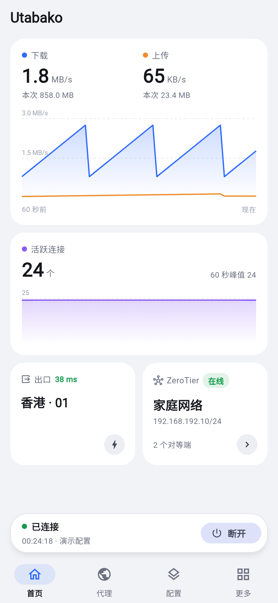
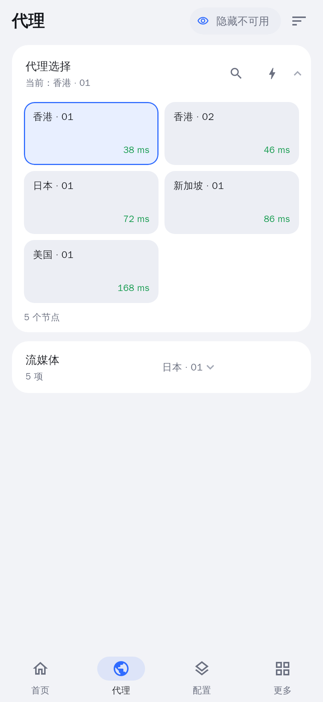
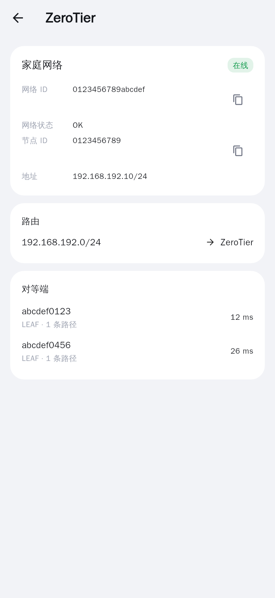

  

<h1 align="center">Utabako</h1>

支持代理分流与虚拟局域网的 Android 客户端

  
  
  

  <a href="#界面">界面预览</a> ·
  <a href="#使用">使用</a> ·
  <a href="BUILDING.md">构建说明</a>

## 界面

  
  
  

## 特性

- **代理与虚拟局域网**：在同一个 VPN 服务中使用代理分流与虚拟局域网。
- **节点选择与测速**：策略组切换、节点搜索、单节点及整组测速，支持延迟排序和节点筛选。
- **订阅与配置**：从 URL、JSON 文件或剪贴板导入，校验配置和规则后完成更新。
- **流量与日志**：查看实时速率、流量历史、连接数，支持查看和导出运行日志。
- 分应用代理、开机自启、系统快捷设置开关、IPv6 开关。
- 浅色与深色主题，可手动选择或跟随系统。

## 使用

1. 打开「配置」，添加订阅 URL 或导入完整的 sing-box JSON 配置，保存并启用。
2. 回到首页点击「连接」，授予系统 VPN 权限。
3. 在「代理」中选择节点，或先测速再选择。

ZeroTier 网络详情可从首页进入，查看地址、路由和对等节点，网络授权在对应控制器中完成。

如果配置的规则通过 ZeroTier 下载，首次连接可能会显示「等待 ZeroTier 授权」。点「查看节点 ID」并在控制器授权，应用会继续加载规则。

## 许可与致谢

Utabako 以 [GPL-3.0-or-later](LICENSE) 开源。

原生内核 [Utabako Core](https://github.com/Utabako/utabako-core) 基于 [sing-box](https://github.com/SagerNet/sing-box) 修改，并集成 [ZeroTier](https://github.com/zerotier/ZeroTierOne)。界面使用 [Flutter](https://github.com/flutter/flutter) 构建。第三方版权与许可原文保留在 [licenses/](licenses/) 中，应用内可查看开源许可。
